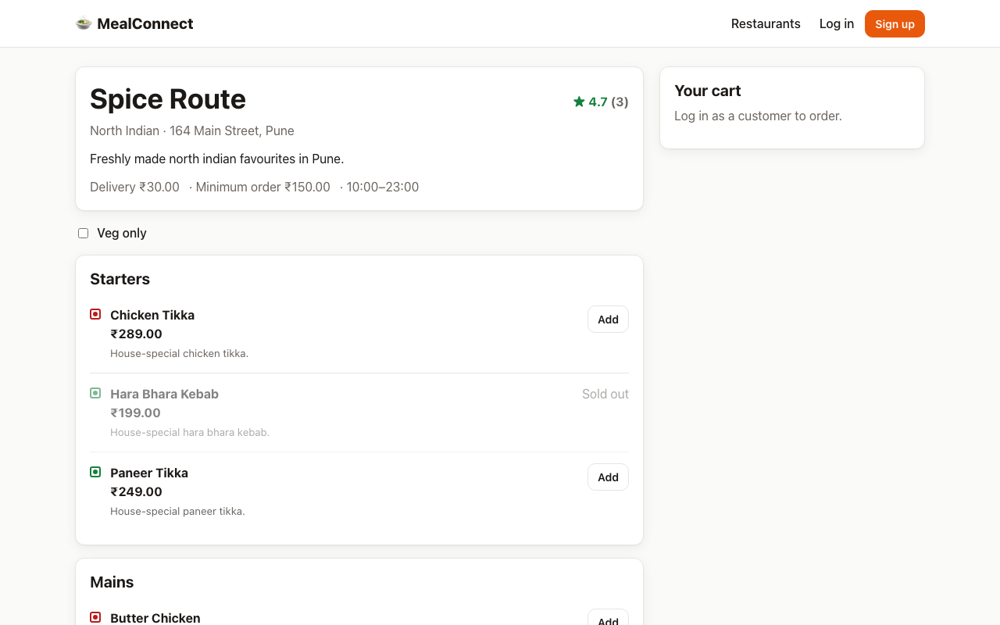
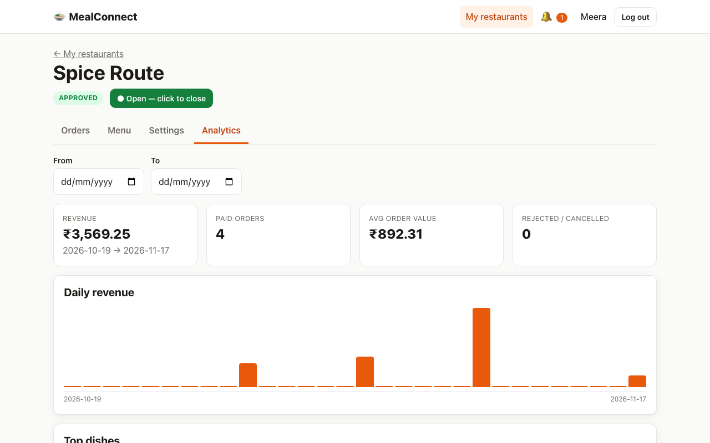
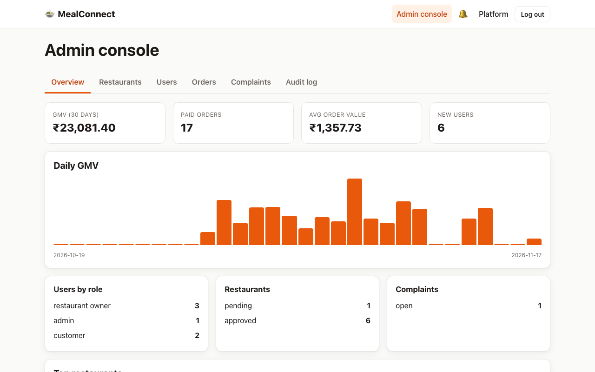
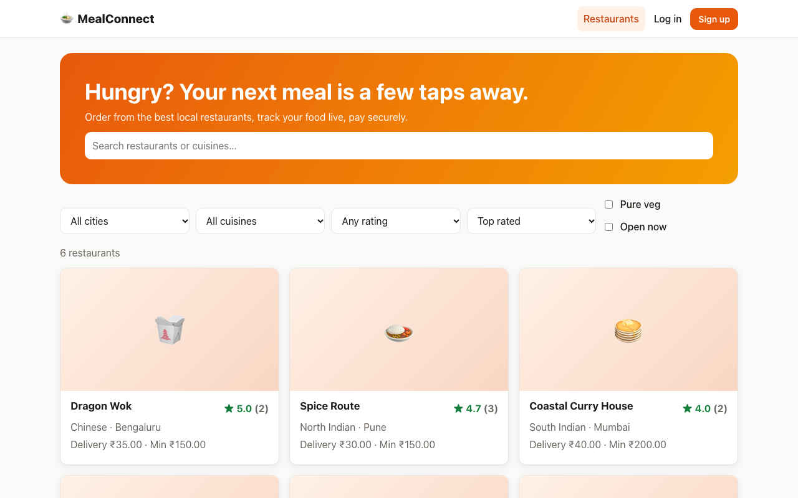
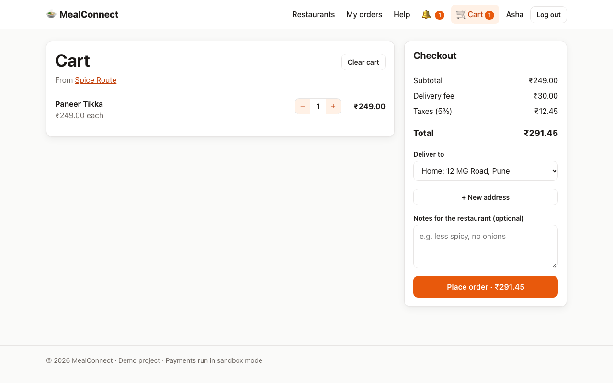
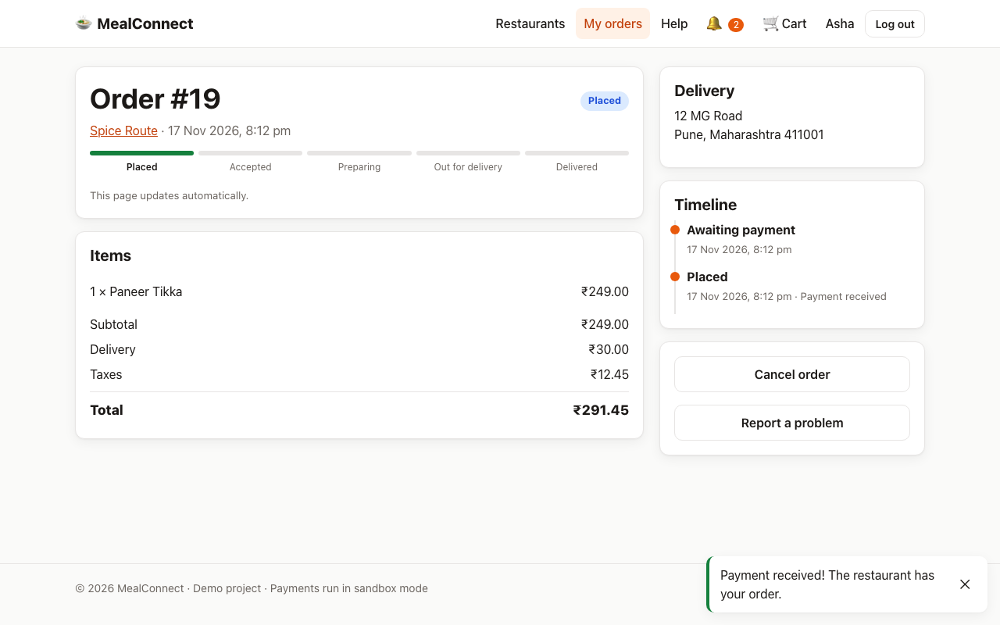
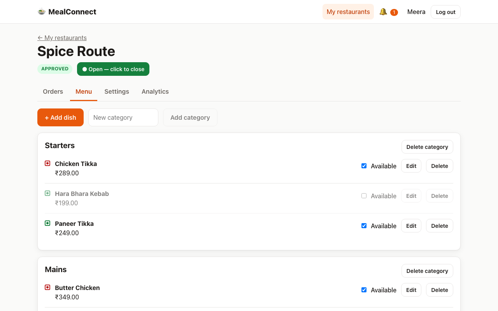
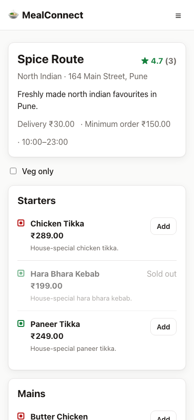

# 🍲 MealConnect

A production-style food ordering and restaurant management platform with three independent roles — **customers**, **restaurant owners** and **administrators** — built with FastAPI, React, PostgreSQL and Redis, containerised with Docker and deployable to AWS.

| Customer | Restaurant owner | Admin |
|---|---|---|
|  |  |  |

<details><summary>More screenshots</summary>

| Browse | Cart & checkout | Order tracking |
|---|---|---|
|  |  |  |

| Menu management | Mobile |
|---|---|
|  |  |
</details>

## Features

- **Customers:** register/login, browse and search restaurants and dishes (filters, sorting, pagination), server-side cart, checkout with price re-validation, sandbox or Razorpay-test payments, live order tracking, reviews and ratings, complaints, notifications.
- **Restaurant owners:** register restaurants (admin-approved), manage categories, dishes and availability, accept/reject orders and advance their status, sales analytics.
- **Admins:** user and restaurant moderation (suspend, approve), order monitoring and force-cancel, complaint handling, platform analytics, audit log.
- **Platform:** JWT with refresh-token rotation and theft detection, role-based access control, bcrypt, validated inputs, DB transactions with row locking, Redis cache with versioned invalidation, rate limiting, background job worker, HMAC-verified idempotent payment webhooks, structured JSON logging with request IDs, OpenAPI docs.

## Tech stack

| Layer | Technology |
|---|---|
| Frontend | React 19, React Router 8, TanStack Query, Axios, plain responsive CSS (dark mode) |
| Backend | Python 3.13, FastAPI, SQLAlchemy 2, Pydantic 2, Alembic |
| Data | PostgreSQL 16 (pg_trgm search), Redis 8 (cache, rate limits, job queue) |
| Payments | Built-in sandbox gateway · Razorpay test mode |
| DevOps | Docker, Docker Compose, Nginx, GitHub Actions, OpenTofu/Terraform for AWS (ECS Fargate, RDS, ElastiCache, CloudFront) |
| Testing | pytest (151 tests, 92 % coverage), Vitest + Testing Library (33), Playwright E2E (desktop + mobile), Postman/Newman (39 requests) |

## Quick start (Docker)

```bash
cp .env.docker.example .env      # replace each CHANGE_ME with: python3 -c "import secrets; print(secrets.token_hex(32))"
docker compose up -d --build
docker compose run --rm -e ENVIRONMENT=development api python -m app.seed --reset   # demo data
open http://localhost:8080       # app   ·   http://localhost:8080/docs  API docs
```

Demo accounts (password `DemoPass123`, local only): `asha@example.com` (customer), `owner.spice@example.com` (owner), `admin@example.com` (admin).

## Local development (macOS)

```bash
brew install postgresql@16 redis node@24 && brew services start postgresql@16 redis
cd backend && python3 -m venv .venv && source .venv/bin/activate && pip install -r requirements-dev.txt
cp .env.example .env             # create the DB role/databases first — see docs/phase-03-environment-setup.md
alembic upgrade head && python -m app.seed --reset
uvicorn app.main:app --reload    # API  http://localhost:8000/docs
python -m app.worker             # background worker (separate terminal)
cd ../frontend && npm install && npm run dev      # web  http://localhost:5173
```

## Testing

```bash
./scripts/test-all.sh            # lint, unit + integration, coverage gates, migrations check, build
./scripts/test-all.sh --full     # + Playwright E2E + Postman/Newman (needs the stack running)
```

## Documentation

| | |
|---|---|
| [Architecture](docs/architecture.md) | Diagrams, key decisions, trade-offs |
| [API reference](docs/api/openapi.json) · live at `/docs` | 69 endpoints, request/response schemas |
| [Requirements, ER diagram, schema, API design](docs/phase-02-system-design/) | Design documents |
| Build guide | [Phases 1–11](docs/) — every step with commands and expected output |
| [Interview prep & resume](docs/phase-13-interview-prep.md) | 50 questions based on this project |
| [Free deployment guide](docs/deployment.md) | Vercel + Render + Neon + Upstash, step by step, env variables, troubleshooting |
| [AWS deployment](docs/phase-11-aws.md) | Terraform + deploy script (validated, not applied) |

## Deployment (free tier)

Architecture: **Vercel** (React) → **Render** (FastAPI + embedded worker) → **Neon** (PostgreSQL) and **Upstash** (Redis). Pushes to `main` run CI; Render deploys only after CI passes and Vercel rebuilds the frontend. Full instructions: [docs/deployment.md](docs/deployment.md).

Live URLs: *not published yet.* They are added here after the deployment has been verified.

## Project layout

```
backend/    FastAPI app (api → services → models), Alembic migrations, tests
frontend/   React app, Vitest tests, Playwright E2E, vercel.json
nginx/      Reverse proxy + static hosting config
infra/      OpenTofu/Terraform for AWS
postman/    API collection + environment
scripts/    smoke test, benchmark, test-all, deploy
render.yaml Render blueprint (free API hosting)
docs/       design, phase guides, screenshots, OpenAPI export
```

## Status

Phases 1–10 complete and verified locally. Phase 11 (AWS) is written and validated but not deployed (requires your AWS account). This is a learning/portfolio project: payments are sandboxed and no real money moves.
