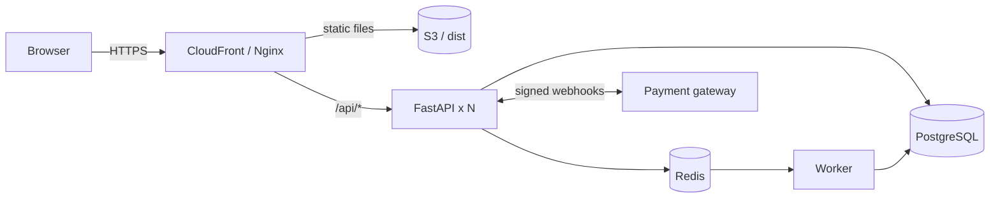

# Architecture

## System

Local Docker uses Nginx in place of CloudFront+S3; AWS adds ALB, ECS Fargate, RDS, ElastiCache ([infra/terraform](../infra/terraform)).

## Backend layers
`api/` (HTTP, auth dependencies) → `services/` (business rules, transactions) → `models/` (SQLAlchemy). `core/` holds config, logging, security, cache, rate limit, jobs. Services raise domain exceptions; one handler turns every error into `{"error": {code, message, details, request_id}}`.

## Order lifecycle
`PENDING_PAYMENT → PLACED → ACCEPTED → PREPARING → OUT_FOR_DELIVERY → DELIVERED`, with `REJECTED`/`CANCELLED` exits. A table maps every allowed (from, to) pair to the actors who may make it. Only a verified payment webhook can place an order.

## Key decisions and trade-offs

| Decision | Why | Trade-off |
|---|---|---|
| Server decides payment, never the browser | Browsers can lie; webhook is HMAC-verified and idempotent (`UNIQUE provider_event_id`) | Frontend polls until the webhook lands |
| Price/address snapshots in `order_items`/`orders` | History must not change when menus change | Some denormalisation |
| Money as `NUMERIC(10,2)`, strings in JSON | No float rounding errors | Clients format only |
| Refresh-token rotation + reuse detection | Limits damage of a stolen token | Needs single-flight refresh + Web Locks in the browser |
| Sync SQLAlchemy in threadpool | Simpler, fully adequate at this scale | Async would help at very high concurrency |
| Redis as optimisation only (circuit breaker, fail open) | Outage must not slow or break the API | Rate limits pause while Redis is down |
| Cache invalidation after commit, versioned list keys | No stale data after writes without tracking every filter combination | Extra `INCR` per catalogue write |
| At-least-once job queue (`BLMOVE`) with idempotent handlers | Never lose a job | Handlers can run twice |
| Fixed-window rate limiting | Two Redis commands, easy to reason about | Bursts at window edges |
| Fargate without NAT gateway | ~$35/month saved; SGs still block inbound | Tasks have public IPs |

## Security summary
bcrypt hashing, 15-minute access tokens, role + ownership checks on every endpoint (404 for others' data), CORS allow-list, security headers (API + Nginx/CloudFront CSP), constant-time signature comparison, secrets only via environment/Secrets Manager, non-root containers, DB and Redis in private subnets with TLS.
