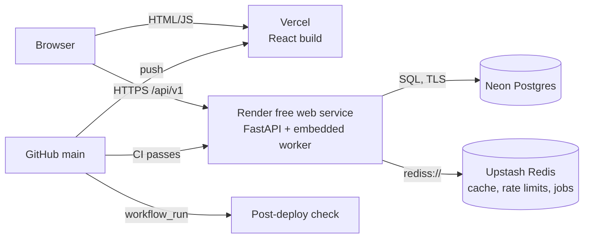

# Free deployment guide: Vercel + Render + Neon + Upstash

Everything below is on free plans, no credit card. Do the steps in order; each ends with a check.



## Free-tier limits you must know

| Service | What you get | Catch |
|---|---|---|
| Render web service (free) | 750 instance hours/month, HTTPS URL | Sleeps after 15 min idle; first request then takes ~1 min. No background workers, shell or disks, so the worker runs inside the API (`EMBEDDED_WORKER`) |
| Neon Postgres (free) | Permanent, 1 GB per project, no card | Compute scales to zero after 5 min idle (first query a moment slower) |
| Upstash Redis (free) | 250 MB, 500K commands/month | Command cap; `WORKER_POLL_SECONDS=20` keeps usage low. Blocking-command support is not guaranteed: the worker falls back to polling automatically |
| Vercel Hobby | Free static hosting, global CDN | Intended for non-commercial use |

Do **not** use Render's free Postgres: it is deleted after 30 days.

## 1. Neon database (5 min)
1. Open https://neon.com and click **Sign up** → **Continue with GitHub**.
2. Create a project named `mealconnect`, Postgres 16 or newer, region **AWS US East 2 (Ohio)**, because Render is set to Ohio too (`region` in `render.yaml` must match the Neon region).
3. On the project dashboard click **Connect**, copy the connection string (`postgresql://…?sslmode=require`). **Treat it as a password**: never paste it into GitHub, chat or a file in this repo.

## 2. Upstash Redis (3 min)
1. Open https://upstash.com → sign in with GitHub → **Create database**, name `mealconnect`, the region nearest Ohio (US East), plan **Free**.
2. Copy the `rediss://default:…@…upstash.io:6379` URL from the **Connect** section (the TLS one, starting `rediss://`).

## 3. Render API (10 min)
1. https://render.com → **Sign up with GitHub**. Install the Render GitHub app for the `mealconnect` repository when asked.
2. **New +** → **Blueprint** → select `akashverma-1408/mealconnect` → branch `main`. Render reads `render.yaml`.
3. Fill the three prompted values:
   - `DATABASE_URL`: the Neon string.
   - `REDIS_URL`: the Upstash `rediss://` URL.
   - `CORS_ORIGINS`: `https://placeholder.invalid` for now (you fix it in step 5).
4. Click **Apply**. The first build takes about 3–5 minutes. Watch **Logs** for `Application startup complete`.
5. Copy the service URL shown at the top (`https://….onrender.com`). **Check:** open `<that URL>/api/v1/health` → `{"status":"ok"}` and `<that URL>/docs` shows Swagger.
6. Check the database link: `<that URL>/api/v1/health/ready` should return `{"status":"ok","checks":{"database":"ok","redis":"ok"}}`. If `redis` is `unavailable` the API still works (Redis is optional); see Troubleshooting.

## 4. Demo data (optional, 2 min, in your Mac terminal)
The tables already exist (the start command ran `alembic upgrade head`). Load demo data into Neon:
```bash
cd ~/Desktop/mealconnect/backend && source .venv/bin/activate
read -s -p "Neon URL: " NEON; echo
DATABASE_URL="$NEON" ENVIRONMENT=development python -m app.seed --reset
unset NEON
```
Demo logins are listed in the README and the seed output. They are public (in this repo), fine for a demo, so never reuse those passwords elsewhere. To create your own admin: `DATABASE_URL="$NEON" python -m app.cli create-admin --email you@example.com --name "You"`.

## 5. Vercel frontend (5 min)
1. https://vercel.com → **Sign up** → **Continue with GitHub**.
2. **Add New… → Project** → import `mealconnect`.
3. **Root Directory**: click **Edit** and choose `frontend`. Framework preset: **Vite** (build `npm run build`, output `dist` are read from `vercel.json`).
4. Open **Environment Variables** and add `VITE_API_URL` = `https://<your-render-url>/api/v1`.
5. **Deploy**. Copy the Vercel URL (`https://….vercel.app`).
6. Back in Render → your service → **Environment** → set `CORS_ORIGINS` to the exact Vercel URL (no trailing slash) → **Save** (it redeploys).

## 6. Automatic deployments
- **Render** deploys on a push to `main` only after the GitHub Actions CI run passes (`autoDeployTrigger: checksPass`).
- **Vercel** builds every push to `main` (production) and every pull request (preview).
- **Post-deploy check:** in GitHub → repository **Settings → Secrets and variables → Actions → Variables** add `API_URL` (Render URL, no path) and `WEB_URL` (Vercel URL). `.github/workflows/post-deploy.yml` then waits for the API, loads the site and verifies CORS after each successful CI run.

## 7. Verify (do all of these)
- [ ] `<API>/api/v1/health/ready` → database ok
- [ ] `<API>/docs` loads
- [ ] `<WEB>` shows restaurants (if you seeded), and a deep link such as `<WEB>/login` loads
- [ ] Register, log in, add to cart, check out; with `PAYMENT_PROVIDER=mock` the sandbox "Pay" step completes the order
- [ ] Browser console has no CORS errors
- [ ] Phone-width layout works
- Run the Postman collection against the live API: `npx newman run postman/MealConnect.postman_collection.json --env-var baseUrl=<API>/api/v1`

## Environment variables

| Variable | Where | Value |
|---|---|---|
| `DATABASE_URL` | Render | Neon string (secret) |
| `REDIS_URL` | Render | Upstash `rediss://` URL (secret; may be left empty) |
| `CORS_ORIGINS` | Render | Vercel URL |
| `JWT_SECRET_KEY`, `PAYMENT_WEBHOOK_SECRET` | Render | generated by Render |
| `ENVIRONMENT=production`, `PAYMENT_PROVIDER=mock`, `SANDBOX_PAYMENTS_ENABLED=true`, `API_DOCS_ENABLED=true` | Render | set by `render.yaml` |
| `EMBEDDED_WORKER`, `WORKER_POLL_SECONDS`, `DB_POOL_SIZE`, `DB_MAX_OVERFLOW`, `REDIS_SOCKET_TIMEOUT`, `TRUSTED_PROXY_COUNT` | Render | free-tier tuning in `render.yaml` |
| `VITE_API_URL` | Vercel | `https://<render-url>/api/v1` |
| `API_URL`, `WEB_URL` | GitHub Actions *variables* | live URLs (not secrets) |

No GitHub Actions *secrets* are needed. Never commit `.env` files.

## Troubleshooting
| Symptom | Cause / fix |
|---|---|
| First page load spins ~1 min, banner "Waking up the server" | Normal Render cold start. |
| Browser: CORS error | `CORS_ORIGINS` differs from the Vercel URL (scheme, trailing slash, preview URL). |
| Render log: `password authentication failed` / `SSL` | Re-copy the Neon string; it must include `sslmode=require`. |
| Render log: `too many connections` | Lower `DB_POOL_SIZE`; use Neon's pooled string. |
| `health/ready` shows redis unavailable | Check the URL starts with `rediss://`; raise `REDIS_SOCKET_TIMEOUT`. The site still works, only caching/rate limits/emails are affected. |
| Local Mac test: `CERTIFICATE_VERIFY_FAILED` when connecting to Upstash | Python from python.org has no CA bundle. `export SSL_CERT_FILE=/etc/ssl/cert.pem` (Render on Linux is not affected). |
| Emails/refunds never processed | Job queue needs Redis. Check Upstash is reachable; look for `worker started` in the Render logs. |
| Login says too many attempts for everyone | Wrong `TRUSTED_PROXY_COUNT`: all users share one IP. Adjust after checking `X-Forwarded-For` in the logs. |

Payments stay in sandbox mode: no real money moves. To use Razorpay test mode set `PAYMENT_PROVIDER=razorpay` plus the `RAZORPAY_*` keys in Render.
