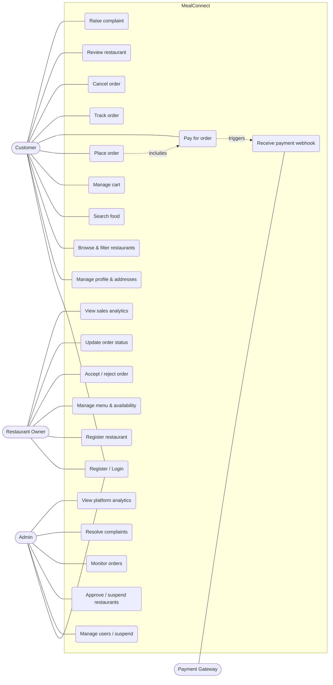
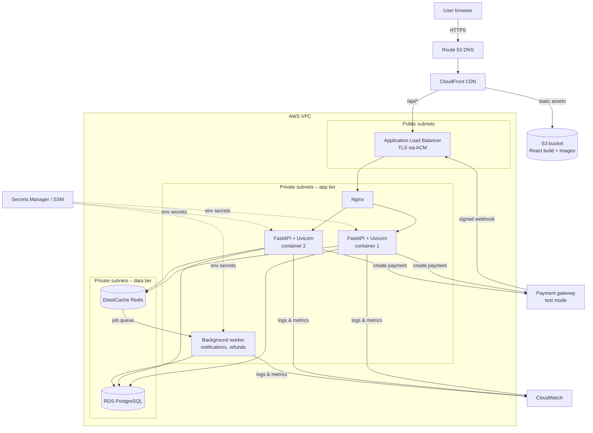
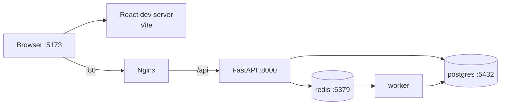
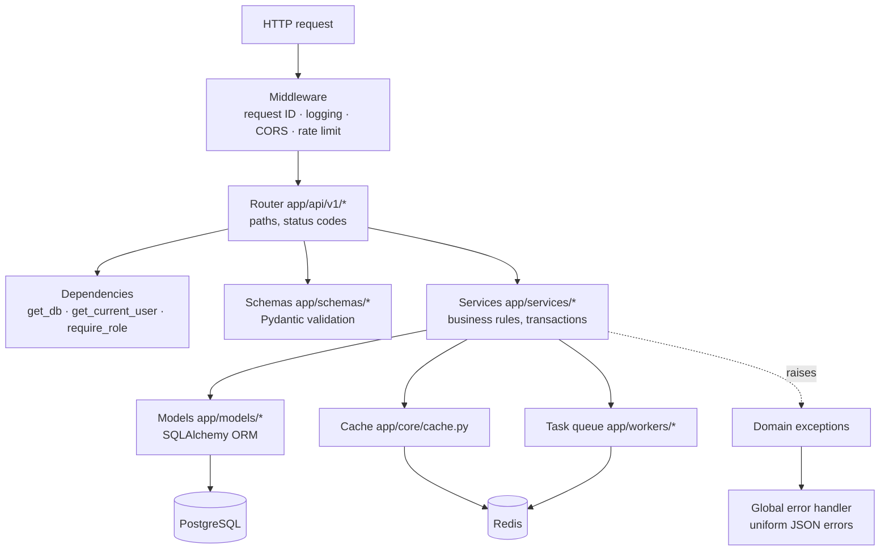
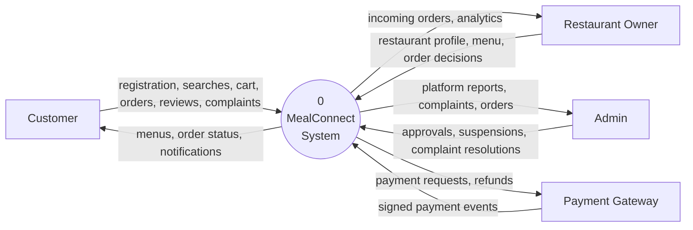
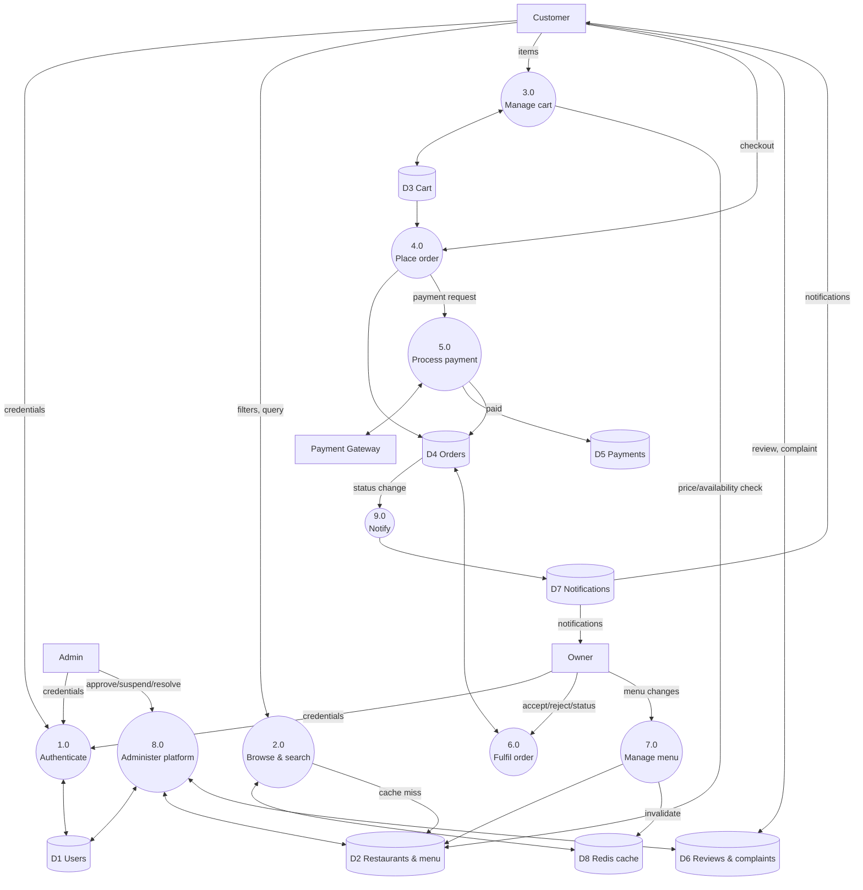
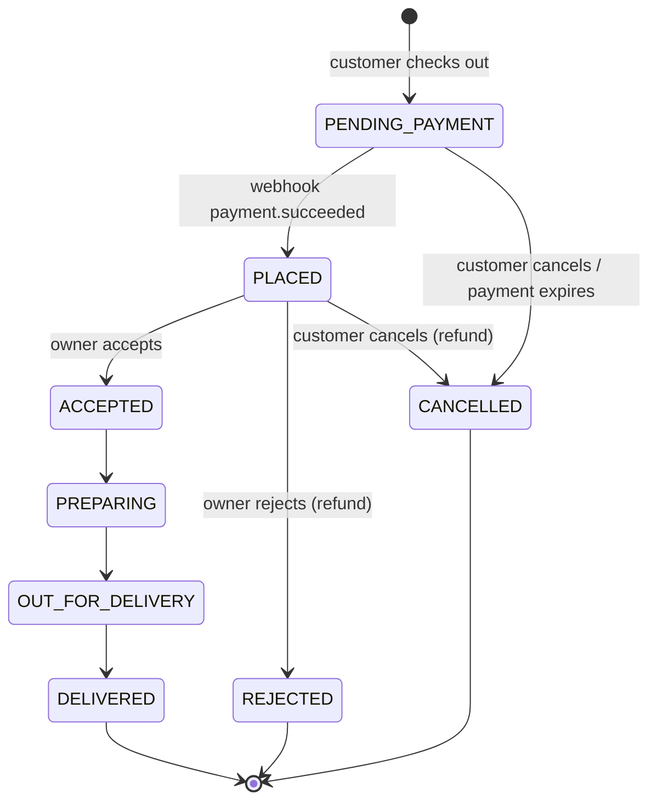
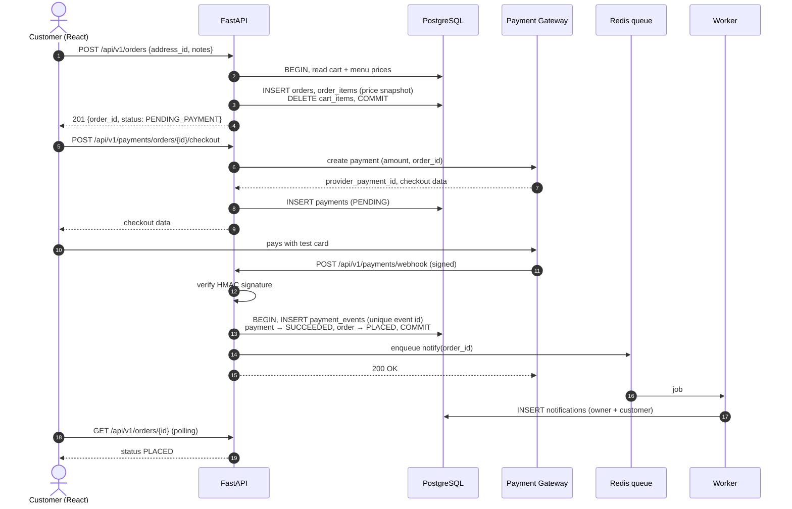

# System Diagrams — MealConnect

All diagrams use **Mermaid**, which GitHub renders automatically. In VS Code, install the "Markdown Preview Mermaid Support" extension to preview them.

---

## 1. Use case diagram

Mermaid has no native UML use-case type, so actors are drawn as boxes and use cases as rounded nodes inside the system boundary.

---

## 2. System architecture diagram

### 2.1 Production (AWS)

### 2.2 Local development (Docker Compose)

### 2.3 Backend internal layers

---

## 3. Data flow diagrams (DFD)

### 3.1 Level 0 — context diagram

### 3.2 Level 1 — main processes and data stores

---

## 4. Order state machine

| From | Allowed next | Who |
|---|---|---|
| PENDING_PAYMENT | PLACED / CANCELLED | System (webhook) / Customer |
| PLACED | ACCEPTED / REJECTED / CANCELLED | Owner / Owner / Customer |
| ACCEPTED | PREPARING | Owner |
| PREPARING | OUT_FOR_DELIVERY | Owner |
| OUT_FOR_DELIVERY | DELIVERED | Owner |

Admins can force `CANCELLED` from any non-final state (audited).

---

## 5. Sequence diagram — checkout and payment

