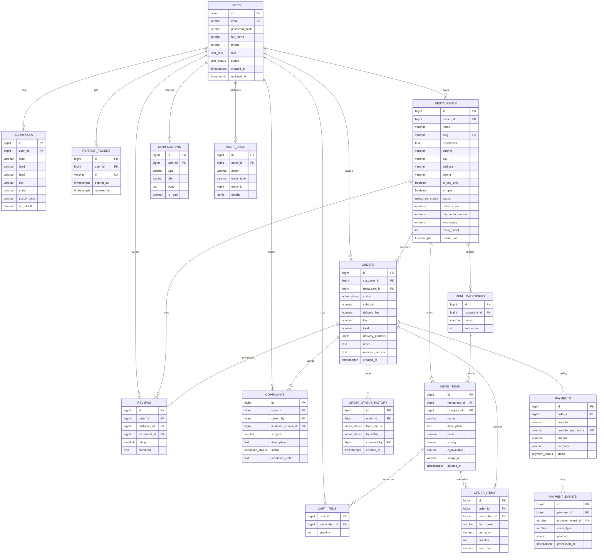

# Database Design — MealConnect (PostgreSQL 16)

## 1. Design decisions

| Decision | Choice | Why |
|---|---|---|
| Primary keys | `BIGINT GENERATED ALWAYS AS IDENTITY` | Fast, small, ordered; simple to learn. Never expose sequential IDs as a security measure — authorization checks protect data. |
| Money | `NUMERIC(10,2)` | Exact decimal math. `FLOAT` gives rounding errors (0.1 + 0.2 ≠ 0.3). |
| Timestamps | `TIMESTAMPTZ` stored in UTC, default `now()` | Time-zone safe. |
| Enums | PostgreSQL `ENUM` types via SQLAlchemy | DB rejects invalid values. |
| Deletes | Soft delete (`deleted_at`) for menu items and restaurants; hard delete for cart rows | Orders reference items; history must survive. |
| Snapshots | `order_items` copies name + price; `orders` copies address | Later edits must not change past orders. |
| Search | `pg_trgm` extension + GIN index on names | Fast partial, case-insensitive `ILIKE '%biryani%'`. |
| Naming | `snake_case`, plural table names | Convention. |

## 2. ER diagram

## 3. Enum types

| Type | Values |
|---|---|
| `user_role` | `customer`, `restaurant_owner`, `admin` |
| `user_status` | `active`, `suspended` |
| `restaurant_status` | `pending`, `approved`, `rejected`, `suspended` |
| `order_status` | `PENDING_PAYMENT`, `PLACED`, `ACCEPTED`, `REJECTED`, `PREPARING`, `OUT_FOR_DELIVERY`, `DELIVERED`, `CANCELLED` |
| `payment_status` | `pending`, `succeeded`, `failed`, `refunded` |
| `complaint_status` | `open`, `in_progress`, `resolved`, `rejected` |

## 4. Table specifications

Every table also has `created_at TIMESTAMPTZ NOT NULL DEFAULT now()`; mutable tables have `updated_at`.

### users
| Column | Type | Constraints |
|---|---|---|
| id | BIGINT identity | PK |
| email | VARCHAR(255) | NOT NULL, UNIQUE (stored lowercase) |
| password_hash | VARCHAR(255) | NOT NULL |
| full_name | VARCHAR(120) | NOT NULL |
| phone | VARCHAR(20) | NULL |
| role | user_role | NOT NULL DEFAULT 'customer' |
| status | user_status | NOT NULL DEFAULT 'active' |
| suspended_reason | TEXT | NULL |

Indexes: `UNIQUE(email)`, `(role, status)`.

### addresses
| Column | Type | Constraints |
|---|---|---|
| id | BIGINT | PK |
| user_id | BIGINT | FK → users ON DELETE CASCADE, NOT NULL |
| label | VARCHAR(30) | e.g. Home/Work |
| line1, line2 | VARCHAR(255) | line1 NOT NULL |
| city, state | VARCHAR(80) | NOT NULL |
| postal_code | VARCHAR(12) | NOT NULL |
| is_default | BOOLEAN | DEFAULT false |

Indexes: `(user_id)`; partial unique `(user_id) WHERE is_default` — at most one default address.

### refresh_tokens
`jti` = unique token ID inside the JWT. Rotation: on refresh, set `revoked_at` on the old row and insert a new one. Index `(user_id)`, `UNIQUE(jti)`.

### restaurants
| Column | Type | Constraints |
|---|---|---|
| owner_id | BIGINT | FK → users ON DELETE RESTRICT |
| name | VARCHAR(120) | NOT NULL |
| slug | VARCHAR(140) | UNIQUE (URL-friendly name) |
| cuisine | VARCHAR(60) | NOT NULL |
| city | VARCHAR(80) | NOT NULL |
| status | restaurant_status | DEFAULT 'pending' |
| delivery_fee | NUMERIC(10,2) | CHECK ≥ 0, DEFAULT 0 |
| min_order_amount | NUMERIC(10,2) | CHECK ≥ 0, DEFAULT 0 |
| avg_rating | NUMERIC(2,1) | CHECK 0–5, DEFAULT 0 (denormalized for fast sorting) |
| rating_count | INT | DEFAULT 0 |
| opens_at, closes_at | TIME | NULL |

Indexes: `(status, city)`, `(owner_id)`, GIN trigram on `name`, `(avg_rating DESC)`.

### menu_categories
`UNIQUE(restaurant_id, name)`; FK restaurant ON DELETE CASCADE.

### menu_items
| Column | Type | Constraints |
|---|---|---|
| restaurant_id | BIGINT | FK → restaurants, NOT NULL |
| category_id | BIGINT | FK → menu_categories ON DELETE SET NULL |
| name | VARCHAR(120) | NOT NULL |
| price | NUMERIC(10,2) | NOT NULL, CHECK > 0 |
| is_veg | BOOLEAN | NOT NULL |
| is_available | BOOLEAN | DEFAULT true |
| deleted_at | TIMESTAMPTZ | NULL = active |

Indexes: `(restaurant_id, is_available) WHERE deleted_at IS NULL`, GIN trigram on `name`.

### cart_items
Composite PK `(user_id, menu_item_id)` — the same item appears once, quantity changes instead. `quantity CHECK (quantity BETWEEN 1 AND 50)`. One-restaurant rule enforced in the service layer.

### orders
| Column | Type | Constraints |
|---|---|---|
| customer_id | BIGINT | FK → users RESTRICT |
| restaurant_id | BIGINT | FK → restaurants RESTRICT |
| status | order_status | DEFAULT 'PENDING_PAYMENT' |
| subtotal, delivery_fee, tax, total | NUMERIC(10,2) | CHECK ≥ 0; CHECK total = subtotal + delivery_fee + tax |
| delivery_address | JSONB | NOT NULL (snapshot) |
| rejection_reason | TEXT | NULL |

Indexes: `(customer_id, created_at DESC)`, `(restaurant_id, status, created_at DESC)`, `(status, created_at)`.

### order_items
`quantity CHECK > 0`, `unit_price CHECK ≥ 0`, `line_total = unit_price * quantity` (CHECK). FK order ON DELETE CASCADE, FK menu_item ON DELETE RESTRICT. Index `(order_id)`, `(menu_item_id)` for "top items" analytics.

### order_status_history
Append-only timeline for tracking. Index `(order_id, created_at)`.

### payments
`UNIQUE(order_id)` — one payment record per order (retries update it). `UNIQUE(provider_payment_id)`. `amount CHECK > 0`.

### payment_events
`UNIQUE(provider_event_id)` gives **idempotency**: a duplicate webhook fails the insert, so we skip it.

### reviews
`UNIQUE(order_id)` (one review per order), `rating CHECK BETWEEN 1 AND 5`. Index `(restaurant_id, created_at DESC)`. Inserting a review updates `restaurants.avg_rating` / `rating_count` in the same transaction.

### complaints
FK `order_id` NULL allowed (general complaints). Index `(status, created_at)`, `(raised_by)`.

### notifications
Index `(user_id, is_read, created_at DESC)`.

### audit_logs
Append-only. Index `(entity_type, entity_id)`, `(actor_id, created_at)`.

## 5. Relationship summary

| Relationship | Type | Implemented by |
|---|---|---|
| User → Restaurants | 1 : N | restaurants.owner_id |
| Restaurant → Menu items | 1 : N | menu_items.restaurant_id |
| Customer ↔ Menu items (cart) | M : N | cart_items (composite PK) |
| Order ↔ Menu items | M : N | order_items |
| Order → Payment | 1 : 0..1 | payments.order_id UNIQUE |
| Order → Review | 1 : 0..1 | reviews.order_id UNIQUE |
| Payment → Events | 1 : N | payment_events.payment_id |

## 6. Normalization check
- **1NF**: atomic columns, no repeating groups (items live in `order_items`, not a comma list).
- **2NF**: composite-key table `cart_items` has only `quantity`, which depends on the whole key.
- **3NF**: no column depends on a non-key column — except the **deliberate denormalizations** (`avg_rating`, snapshots in `order_items`/`orders`), chosen for performance and historical correctness.
