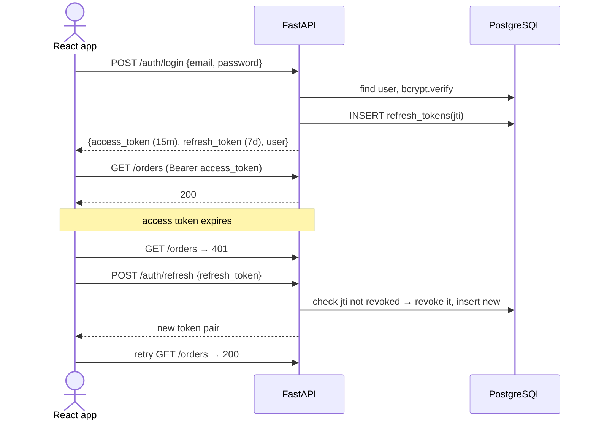

# REST API Architecture — MealConnect

Base URL: `/api/v1` · Format: JSON · Auth: `Authorization: Bearer <access_token>`
Interactive docs (generated by FastAPI): `/docs` (Swagger UI) and `/redoc`.

## 1. Conventions

| Topic | Rule |
|---|---|
| Naming | Plural nouns, kebab-case: `/menu-items`, `/restaurants/{restaurant_id}` |
| Versioning | URL prefix `/api/v1` |
| IDs | Path params are integers; `404` if not found **or not yours** (don't leak existence) |
| Timestamps | ISO-8601 UTC: `2026-11-17T10:30:00Z` |
| Money | Strings with 2 decimals: `"249.00"` (avoids JS float issues) |
| Partial update | `PATCH` with only changed fields |
| Pagination | `?page=1&size=20` (size max 100) |
| Sorting | `?sort=-avg_rating` (`-` = descending) |
| Filtering | Plain query params: `?city=Pune&is_veg=true&min_rating=4` |

### Paginated response
```json
{
  "items": [ ... ],
  "total": 134,
  "page": 1,
  "size": 20,
  "pages": 7
}
```

### Error response (every error, same shape)
```json
{
  "error": {
    "code": "ORDER_INVALID_TRANSITION",
    "message": "Cannot move order from PLACED to DELIVERED",
    "details": null,
    "request_id": "8f2c1a7e-..."
  }
}
```

| Status | When |
|---|---|
| 200 / 201 / 204 | OK / created / deleted, no body |
| 400 | Bad request or business rule violated (e.g. cart from two restaurants) |
| 401 | Missing/expired/invalid token |
| 403 | Logged in but wrong role or suspended |
| 404 | Not found (or not owned by caller) |
| 409 | Conflict (email exists, duplicate review) |
| 422 | Validation error (Pydantic) — `details` lists the fields |
| 429 | Rate limit exceeded (`Retry-After` header) |
| 500 | Unexpected server error (logged with request_id) |

## 2. Authentication flow



JWT payload: `{"sub": "42", "role": "customer", "type": "access", "exp": 1763380000, "jti": "..."}`.

## 3. Endpoint catalogue

Legend — **Auth**: `-` public, `U` any logged-in user, `C` customer, `O` restaurant owner (and owns the resource), `A` admin.

### 3.1 System
| Method | Path | Auth | Description |
|---|---|---|---|
| GET | `/health` | - | Liveness: `{"status":"ok"}` |
| GET | `/health/ready` | - | Checks DB + Redis |

### 3.2 Auth & profile
| Method | Path | Auth | Description | Req ID |
|---|---|---|---|---|
| POST | `/auth/register` | - | Register customer or owner | AUTH-1,2 |
| POST | `/auth/login` | - | Get token pair (rate-limited) | AUTH-3,8 |
| POST | `/auth/refresh` | - | Rotate tokens | AUTH-4 |
| POST | `/auth/logout` | U | Revoke refresh token | AUTH-5 |
| GET | `/users/me` | U | Current profile | AUTH-7 |
| PATCH | `/users/me` | U | Update name/phone | AUTH-7 |
| POST | `/users/me/change-password` | U | Change password | AUTH-7 |
| GET | `/users/me/addresses` | C | List addresses | AUTH-7 |
| POST | `/users/me/addresses` | C | Add address | AUTH-7 |
| PATCH | `/users/me/addresses/{id}` | C | Edit address | AUTH-7 |
| DELETE | `/users/me/addresses/{id}` | C | Delete address | AUTH-7 |

### 3.3 Catalogue (public browsing)
| Method | Path | Auth | Description | Req ID |
|---|---|---|---|---|
| GET | `/restaurants` | - | List approved restaurants. Query: `q, city, cuisine, is_veg, min_rating, open_now, sort, page, size` (cached) | CUS-1,2,3 |
| GET | `/restaurants/{id}` | - | Restaurant detail | CUS-4 |
| GET | `/restaurants/{id}/menu` | - | Categories with items (cached) | CUS-4 |
| GET | `/restaurants/{id}/reviews` | - | Paginated reviews | CUS-10 |
| GET | `/search/menu-items` | - | Dish search: `q, city, is_veg, max_price, page, size` | CUS-3 |

### 3.4 Cart
| Method | Path | Auth | Description | Req ID |
|---|---|---|---|---|
| GET | `/cart` | C | Cart with items, restaurant, computed totals | CUS-5 |
| POST | `/cart/items` | C | `{menu_item_id, quantity}`; `409 CART_RESTAURANT_MISMATCH` if other restaurant | CUS-5 |
| PATCH | `/cart/items/{menu_item_id}` | C | `{quantity}` | CUS-5 |
| DELETE | `/cart/items/{menu_item_id}` | C | Remove one item | CUS-5 |
| DELETE | `/cart` | C | Clear cart | CUS-5 |

### 3.5 Orders (customer)
| Method | Path | Auth | Description | Req ID |
|---|---|---|---|---|
| POST | `/orders` | C | Create order from cart `{address_id, notes}` (transaction) | CUS-6 |
| GET | `/orders` | C | My orders, `status, page, size` | CUS-8 |
| GET | `/orders/{id}` | C | Order detail + status timeline | CUS-8 |
| POST | `/orders/{id}/cancel` | C | Cancel if allowed | CUS-9 |
| POST | `/orders/{id}/review` | C | `{rating, comment}` — delivered only, once | CUS-10 |

### 3.6 Payments
| Method | Path | Auth | Description | Req ID |
|---|---|---|---|---|
| POST | `/payments/orders/{order_id}/checkout` | C | Create gateway payment, return checkout data | PAY-1 |
| POST | `/payments/webhook` | - (signature) | Gateway events; HMAC verified, idempotent | PAY-2,3,4 |
| GET | `/payments/orders/{order_id}` | C | Payment status | PAY-4 |

### 3.7 Complaints & notifications
| Method | Path | Auth | Description | Req ID |
|---|---|---|---|---|
| POST | `/complaints` | C | `{order_id?, subject, description}` | CUS-11 |
| GET | `/complaints` | C | My complaints | CUS-11 |
| GET | `/notifications` | U | `is_read, page, size` | CUS-12 |
| PATCH | `/notifications/{id}/read` | U | Mark read | CUS-12 |
| POST | `/notifications/read-all` | U | Mark all read | CUS-12 |

### 3.8 Restaurant owner (`/owner/...`)
| Method | Path | Auth | Description | Req ID |
|---|---|---|---|---|
| POST | `/owner/restaurants` | O | Register restaurant (status `pending`) | RES-1 |
| GET | `/owner/restaurants` | O | My restaurants | RES-10 |
| GET | `/owner/restaurants/{rid}` | O | Detail | RES-10 |
| PATCH | `/owner/restaurants/{rid}` | O | Update profile, `is_open` | RES-2 |
| GET/POST | `/owner/restaurants/{rid}/categories` | O | List / create categories | RES-3 |
| PATCH/DELETE | `/owner/restaurants/{rid}/categories/{cid}` | O | Edit / delete category | RES-3 |
| GET/POST | `/owner/restaurants/{rid}/menu-items` | O | List / create items | RES-3 |
| PATCH | `/owner/restaurants/{rid}/menu-items/{iid}` | O | Update item | RES-3 |
| PATCH | `/owner/restaurants/{rid}/menu-items/{iid}/availability` | O | `{is_available}` | RES-4 |
| DELETE | `/owner/restaurants/{rid}/menu-items/{iid}` | O | Soft delete | RES-5 |
| GET | `/owner/restaurants/{rid}/orders` | O | Incoming orders: `status, date_from, date_to, page` | RES-6 |
| POST | `/owner/orders/{oid}/accept` | O | PLACED → ACCEPTED | RES-7 |
| POST | `/owner/orders/{oid}/reject` | O | `{reason}` → REJECTED + refund | RES-7 |
| PATCH | `/owner/orders/{oid}/status` | O | `{status}` next valid step | RES-8 |
| GET | `/owner/restaurants/{rid}/analytics` | O | `date_from, date_to` → revenue, orders, AOV, top items, daily series | RES-9 |

### 3.9 Admin (`/admin/...`)
| Method | Path | Auth | Description | Req ID |
|---|---|---|---|---|
| GET | `/admin/users` | A | `role, status, q, page` | ADM-1 |
| GET | `/admin/users/{id}` | A | User detail | ADM-1 |
| PATCH | `/admin/users/{id}/status` | A | `{status, reason}` suspend/reactivate | ADM-2 |
| GET | `/admin/restaurants` | A | `status, city, q, page` | ADM-3 |
| PATCH | `/admin/restaurants/{id}/status` | A | `{status, reason}` approve/reject/suspend | ADM-3 |
| GET | `/admin/orders` | A | `status, restaurant_id, date_from, date_to, page` | ADM-4 |
| POST | `/admin/orders/{id}/cancel` | A | Force cancel (audited) | ADM-4 |
| GET | `/admin/complaints` | A | `status, page` | ADM-5 |
| PATCH | `/admin/complaints/{id}` | A | `{status, assigned_admin_id, resolution_note}` | ADM-5 |
| GET | `/admin/analytics/overview` | A | GMV, orders/day, users/day, top restaurants | ADM-6 |
| GET | `/admin/audit-logs` | A | `actor_id, entity_type, page` | ADM-7 |

**Total: ~65 endpoints.**

## 4. Sample request / response

`POST /api/v1/orders`
```json
{ "address_id": 7, "notes": "Less spicy please" }
```
`201 Created`
```json
{
  "id": 1024,
  "status": "PENDING_PAYMENT",
  "restaurant": { "id": 3, "name": "Spice Route" },
  "items": [
    { "menu_item_id": 51, "item_name": "Paneer Tikka", "unit_price": "249.00", "quantity": 2, "line_total": "498.00" }
  ],
  "subtotal": "498.00",
  "delivery_fee": "30.00",
  "tax": "24.90",
  "total": "552.90",
  "created_at": "2026-11-17T10:30:00Z"
}
```

## 5. Cross-cutting concerns

| Concern | Implementation |
|---|---|
| Authentication | `get_current_user` dependency decodes JWT, loads user, rejects suspended |
| Authorization | `require_role(*roles)` dependency + ownership checks in services |
| Validation | Pydantic v2 schemas with field constraints |
| Rate limiting | Redis fixed-window counter middleware: key `rl:{ip or user}:{route}:{minute}` |
| Caching | Redis keys `restaurants:list:{hash(query)}`, `restaurant:{id}:menu`; invalidated on owner/admin writes |
| Background jobs | Redis-backed queue (ARQ) worker: notifications, refunds |
| Logging | JSON logs (`structlog`/stdlib) with `request_id`, method, path, status, duration |
| CORS | Allow-list from env var `CORS_ORIGINS` |
| Docs | OpenAPI auto-generated, tags per module, examples in schemas |

## 6. Planned backend folder layout (built in Phase 4)

```
backend/
├── app/
│   ├── main.py              # FastAPI app factory, middleware, routers
│   ├── core/                # config.py, security.py, logging.py, cache.py, rate_limit.py, exceptions.py
│   ├── db/                  # base.py, session.py
│   ├── models/              # one file per table group
│   ├── schemas/             # Pydantic request/response models
│   ├── services/            # business logic
│   ├── api/
│   │   ├── deps.py          # get_db, get_current_user, require_role
│   │   └── v1/              # auth.py, restaurants.py, cart.py, orders.py, payments.py, owner.py, admin.py ...
│   └── workers/             # background tasks
├── alembic/                 # migrations
├── tests/
├── pyproject.toml / requirements.txt
└── .env.example
```
